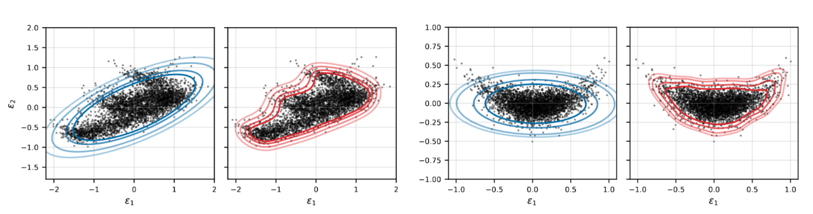

# A Kernel Nonconformity Score for Multivariate Conformal Prediction

Code for the NeurIPS 2026 paper by Louis Meyer and Wenkai Xu. It contains the
Multivariate Kernel Score (MKS), the baselines, every experiment in the paper,
the raw results behind every table, and the notebooks that build the tables
and figures.



## Layout

```
scorers.py               Mahalanobis, Bonferroni, density and kernel (MKS) scores
otcp_scorer.py           optimal transport baseline of Klein et al. (2025)
volume_estimator.py      Monte Carlo volumes, synthetic experiments
volume_estimator_new.py  Monte Carlo volume ratios, real-data experiments
metrics.py               worst-slab coverage
experiment.py            synthetic experiment, one seed
pipeline.py              data generation, split and model fits (synthetic)
data/feldman/            where the Bio, House and Blog datasets go

realdata_experiments/
    datasets.py          every (dataset, output dimension) configuration
    run.py               runs one configuration, seed and model
    job.slurm, submit_all.sh   every cluster run behind the paper
    tables.py            LaTeX tables from the results
    paper_tables.ipynb   real-data tables
    results_clean/       raw results of every real-data run
    hyperparam_grid/     lengthscale and regularization grids

synthetic_experiments/
    synthetic.ipynb      synthetic runs, table and figures
    results/synthetic_2d/  raw results of the synthetic runs
```

## Installation

```
pip install -r requirements_local.txt
```

`requirements_cluster.txt` is the environment used for the real-data runs.

## Data

The three real-data datasets are not included. `data/feldman/README.md` lists
them and the file names the code expects.

## Reproducing the tables

The raw results are included, so the tables can be rebuilt without rerunning
anything.

- `realdata_experiments/paper_tables.ipynb` builds the real-data tables from `results_clean/`.
- `realdata_experiments/hyperparam_grid/grid_tables.ipynb` builds the hyperparameter grids.
- `synthetic_experiments/synthetic.ipynb` runs the synthetic experiment and builds its table and figures.

## Rerunning the real-data experiments

The real-data runs were made on a SLURM cluster. Set up your Python
environment in `realdata_experiments/job.slurm`, then from
`realdata_experiments/`

```
DRY=1 ./submit_all.sh       # print every command, submit nothing
P=<your partitions> ./submit_all.sh
```

A single run works without a cluster, for example

```
python run.py bio_2d 0 Ridge --scorers Mahal Bonferroni Density_med2 Kernel_med2 OTCP \
    --alphas 0.01 0.02 0.05 0.1 --kappa 3 --max-kappa 2000 \
    --target-rel-se 0.02 --max-samples 400000 --out-dir my_results/bio_2d
```

Every run is deterministic given its seed. On different hardware, results agree
up to floating-point rounding, except in the corner of the hyperparameter grid
with a very wide kernel and very small regularization, where the regularized
Gram matrix is severely ill-conditioned, and on a few MLP seeds.

## License

MIT, see `LICENSE`. `otcp_scorer.py` is a port of code from OTT-JAX,
distributed under the Apache License 2.0, see `NOTICE`.
